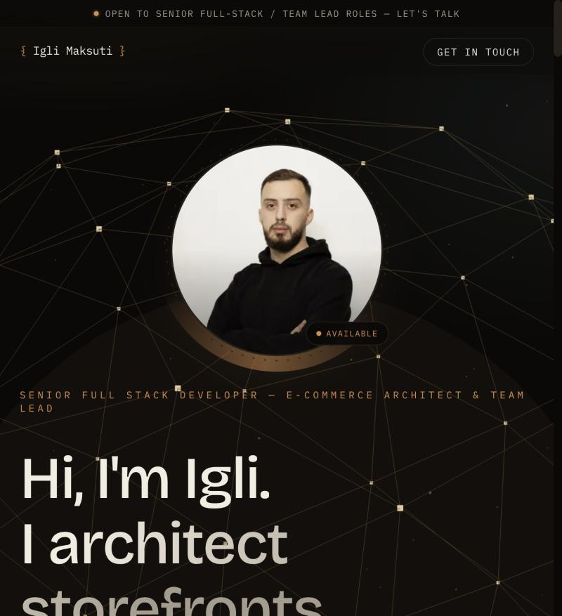

# Igli Maksuti — Portfolio

Personal portfolio site for Igli Maksuti, Senior Full Stack Developer & E‑Commerce Architect based in Tirana, Albania.

**Live:** [igli-portfolio.vercel.app](https://igli-portfolio.vercel.app)



## About

A single-page portfolio built to showcase 5+ years of e-commerce engineering work (Shopify, BigCommerce, Magento) alongside modern full-stack projects. The focus is on motion and interaction design — an interactive 3D background, scroll-driven reveals, and magnetic/tilt micro-interactions — rather than a static resume page.

## Features

- **3D hero background** — an animated network/lattice scene built with React Three Fiber and Three.js
- **Scroll-aware section index** — a fixed progress indicator that tracks which section is in view via `IntersectionObserver`
- **Micro-interactions** — magnetic buttons, tilt cards, split-text and reveal animations powered by Motion (Framer Motion's successor)
- **Content sections** — Hero, Now panel, Approach/What-I-do, Tech stack, Experience timeline, Work showcase, Credentials, and Contact
- **Downloadable résumé** served directly from the site
- Fully responsive, dark-themed, and built with performance in mind (Next.js App Router + Turbopack)

## Tech stack

| Layer | Technology |
|---|---|
| Framework | [Next.js 16](https://nextjs.org) (App Router) |
| Language | TypeScript |
| Styling | Tailwind CSS 4 |
| Animation | Motion, React Three Fiber, Drei, Three.js |
| Deployment | Vercel |

## Getting started

```bash
npm install
npm run dev
```

Open [http://localhost:3000](http://localhost:3000) to view it locally.

```bash
npm run build   # production build
npm run lint    # lint the project
```

## Project structure

```
app/
├─ components/        # UI building blocks (cards, scenes, effects)
│  └─ sections/        # Page sections (Hero, Stack, Experience, Work, Contact, ...)
├─ lib/                # Site content/data and motion config
├─ layout.tsx          # Root layout, fonts, metadata
└─ page.tsx            # Page composition
```

## Contact

- **LinkedIn:** [in/igli-maksuti](https://www.linkedin.com/in/igli-maksuti-061400284/)
- **Location:** Tirana, Albania
